# Product Requirement Document (PRD): Edge URL Shortener V1

| Metadata | Value |
| :--- | :--- |
| **Product Name** | Edge URL Shortener |
| **Document Version** | 1.0 (Usable V1) |
| **Author** | Senior Product Manager |
| **Status** | Approved for V1 Implementation |
| **Target Infrastructure** | Cloudflare Workers & Cloudflare D1 ($0/mo Forever Tier) |

---

## 1. Purpose

The purpose of the Edge URL Shortener is to provide a zero-cost ($0 operating expense), high-performance URL shortening and link-branding utility. The system guarantees instant, low-latency redirection for human users while proxying rich, high-fidelity OpenGraph and Twitter card previews to social media and messaging platforms (WhatsApp, Discord, X/Twitter, LinkedIn).

---

## 2. Problem Statement

1. **High Cost & Hidden Fees:** Traditional commercial shorteners (e.g., Bitly, TinyURL) gate basic features (custom slugs, API access, link editing) behind $10–$35/month recurring subscriptions.
2. **Broken Social Previews:** When standard shortened links are posted in messaging apps or social networks, the crawler bot frequently follows redirect chains inefficiently or fails to extract metadata from client-rendered SPAs, resulting in blank, broken, or text-only preview cards.
3. **Database Sleep & Cold-Start Latency:** Self-hosted open-source alternatives deployed on free platforms (such as Supabase or Render) suffer from container cold starts (500ms–2000ms) or get paused after 7 days of inactivity.
4. **Link Trust & Aesthetics:** Random long links look untrustworthy and unclickable without a clean slug and rich preview card.

---

## 3. Target Users

1. **Developers & Technical Operators:**
   * Need a lightweight REST API to shorten links programmatically from scripts, CLI tools, GitHub Actions, and internal workflows without managing API billing or token quotas.
2. **Community Managers & Content Creators:**
   * Share links daily across WhatsApp groups, Discord communities, X/Twitter, and LinkedIn.
   * Require links that always display high-impact preview cards (title, description, and thumbnail banner), even if the original target page has no native social image.
3. **General Users:**
   * Need a fast, clean, zero-clutter web dashboard to paste a long link, optionally pick a vanity name, and copy the short link with one click.

---

## 4. Core Features (V1 Usable Scope Only)

### 4.1 Dual Access Interface
* **Public Web Interface (`GET /`):**
  * Minimalist, responsive dark-mode dashboard.
  * Inputs: Target Destination URL (required), Custom Slug (optional), Manual Title/Desc/Image Overrides (optional).
  * Output: One-click "Copy" button for the generated short link + Live Social Preview Card emulator showing how the link appears on social feeds.
* **Developer REST API (`POST /api/shorten`):**
  * Accepts standard JSON payloads: `{"url": "...", "custom_slug": "..."}`.
  * Returns structured JSON: `{"success": true, "slug": "...", "short_url": "...", "metadata": {...}}`.
  * Optional Bearer Token authentication (`Authorization: Bearer <API_KEY>`) to protect private automated pipelines.

### 4.2 Sub-10ms Human Redirection Engine (`GET /:slug`)
* Fast-path lookup against Cloudflare D1 clustered SQLite storage.
* Issues an HTTP `307 Temporary Redirect` to the destination URL.
* Sets edge cache headers (`Cache-Control: public, s-maxage=86400, stale-while-revalidate=604800`) to enable Cloudflare’s 300+ anycast edge PoPs to resolve repeat clicks directly out of physical edge RAM in **<10ms**.

### 4.3 Social Preview Proxying & Dynamic Visual Fallback
* Evaluates incoming `User-Agent` headers against known social bot signatures (`facebookexternalhit`, `Twitterbot`, `Discordbot`, `WhatsApp`, `TelegramBot`, `LinkedInBot`).
* **Crawler Route:** Does *not* redirect immediately. Emits an HTTP `200 OK` response with explicit OpenGraph (`og:title`, `og:image`, `og:description`) and Twitter card tags, accompanied by a `<meta http-equiv="refresh">` and JavaScript redirection fallback.
* **Dynamic SVG Fallback Banner:** If the target destination lacks an `og:image` (e.g., raw GitHub code, documents, text articles), the system generates an in-memory 1200x630 high-resolution SVG card with the site domain and title, guaranteeing that preview cards are never blank.
* **Edge Caching:** Crawled HTML preview cards are cached in Cloudflare’s `caches.default` edge cache for 7 days to eliminate duplicate scraping overhead.

### 4.4 Compact Slugs & Vanity Aliases
* **Auto-Generated Slugs:** 4-character Base62 string (`[0-9a-zA-Z]`, ~14.7 million combinations) generated via cryptographically secure random bytes (`crypto.getRandomValues`).
* **Custom Vanity Slugs:** Alphanumeric, 1–32 characters (`a-z`, `0-9`, `-`, `_`).
* **Reserved Word Guard:** Rejects system collisions (`api`, `health`, `robots.txt`, `favicon.ico`, `dashboard`, `static`).

### 4.5 Security & Anti-Abuse Guardrails
* **Server-Side Request Forgery (SSRF) Guard:** Scraper validates target URLs before fetch; strictly denies private subnets (`10.0.0.0/8`, `172.16.0.0/12`, `192.168.0.0/16`), loopbacks (`127.0.0.1`, `::1`), and cloud metadata IP addresses (`169.254.169.254`).
* **Input Sanitization:** HTML entities in titles and descriptions are escaped to prevent Cross-Site Scripting (XSS) in crawler previews.
* **Scraper Budget:** 2.5-second abort controller on target fetches to prevent slow-drain worker denial-of-service.

---

## 5. App Flow & Architecture Lifecycle

```mermaid
sequenceDiagram
    autonumber
    actor User as Client / Browser / Bot
    participant Edge as Cloudflare Edge Worker
    participant Cache as Cloudflare Edge CDN Cache
    participant D1 as D1 SQLite (WITHOUT ROWID)
    participant Target as Destination Server

    %% Flow 1: Creation
    rect rgb(20, 25, 40)
    Note over User,Target: Flow 1: Shorten Link (Web UI or API)
    User->>Edge: POST /api/shorten {url, custom_slug}
    Edge->>Edge: SSRF & Protocol Check
    Edge->>Target: Best-effort <head> metadata fetch (2.5s timeout)
    Edge->>D1: INSERT INTO urls (slug, target_url, metadata)
    Edge-->>User: 201 Created {short_url, slug, metadata}
    end

    %% Flow 2: Human Visit
    rect rgb(25, 35, 25)
    Note over User,Target: Flow 2: Human User Click
    User->>Edge: GET /:slug (Human Browser UA)
    alt Edge Cache Hit
        Cache-->>User: HTTP 307 Redirect (<10ms TTFB)
    else Edge Cache Miss
        Edge->>D1: SELECT target_url FROM urls WHERE slug = ?
        Edge->>Cache: Store 307 response in CDN cache (24h)
        Edge-->>User: HTTP 307 Redirect (Location: target_url)
    end
    end

    %% Flow 3: Social Crawler
    rect rgb(35, 25, 35)
    Note over User,Target: Flow 3: Social Media Bot (WhatsApp / X / Discord)
    User->>Edge: GET /:slug (Bot UA)
    alt Cache Hit
        Cache-->>User: HTTP 200 OK + Static HTML Preview Card (0ms)
    else Cache Miss
        Edge->>D1: Fetch target_url & metadata
        Edge->>Edge: Render OpenGraph HTML (with SVG fallback card)
        Edge->>Cache: Save to caches.default (7 days)
        Edge-->>User: HTTP 200 OK + OpenGraph Tags + Meta Refresh
    end
    end
```

---

## 6. Success Criteria (Measurable Metrics)

| Metric | Target Goal | Measurement Method |
| :--- | :--- | :--- |
| **Human Redirect Latency** | **< 15ms TTFB** (global average), **< 8ms** on Edge cache hits | Synthetic edge latency monitors across US, EU, and Asia PoPs |
| **Social Card Fidelity** | **100% card presentation** on WhatsApp, Discord, X/Twitter, and LinkedIn | Manual & automated link drop validations |
| **Operating Cost** | **$0.00 / month** permanently | Cloudflare billing invoice verification ($0 plan, no credit card) |
| **Database Reliability** | **Zero instance pausing**; 100% uptime | Continuous synthetic uptime monitor |
| **Test Quality** | **100% pass rate** across SSRF, Slug, Bot, and End-to-End suites | Automated test suite execution (`npm test`) |

---

## 7. Business & Technical Infrastructure Requirements

1. **Permanently Free Tier Invariants:**
   * The application must operate entirely within Cloudflare Workers Free Tier (100,000 requests/day, 10ms CPU time/execution).
   * Storage must reside in Cloudflare D1 (5 GB capacity, 5M reads/day, 100k writes/day free).
   * No third-party external databases requiring subscriptions or credit cards.
2. **Storage Capacity Target:**
   * At ~440 bytes per human-readable link record in clustered `WITHOUT ROWID` storage, the 5 GB tier safely holds **11.2 million shortened URLs**.
3. **Extensibility for Custom Domains:**
   * The V1 service must run seamlessly on default `*.workers.dev` endpoints, but remain architecture-ready to bind a custom apex or subdomain (e.g., `sho.rt` or `*.is-a.dev`) via Cloudflare DNS routing without code modification.

---

## 8. Out of Scope (Non-Goals for V1)

To keep V1 usable, lean, and immediately shippable, the following are explicitly deferred:
* **User Accounts & Multi-Tenant Login:** No OAuth, passwords, or session cookies.
* **Paid Monetization & Subscriptions:** No Stripe, payment rails, or feature tiers.
* **Heavy Analytics Database:** No per-click database logging of IP, geolocation, or referrer headers (avoids exhausting the 100k writes/day database limit). Cloudflare Web Analytics can be toggled at the domain level for free aggregate statistics.
* **Binary Media Hosting:** No binary image uploads; thumbnail previews must be external URLs or dynamically rendered inline SVGs.
